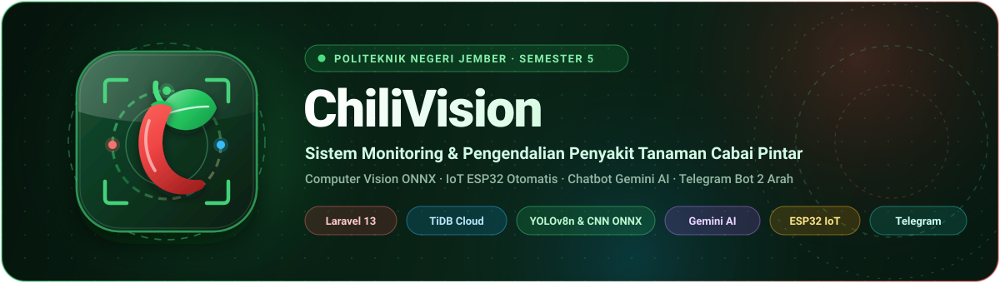
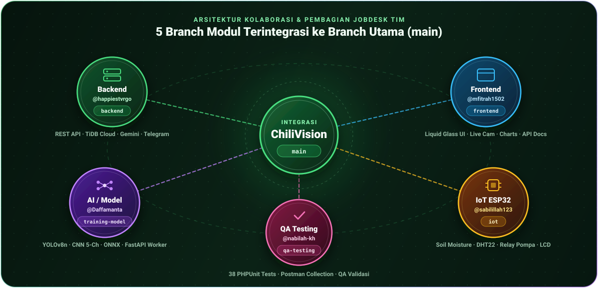
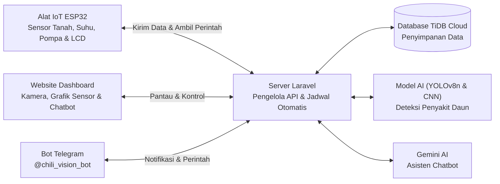

<div align="center">



<br><br>

<picture>
  <source media="(prefers-color-scheme: dark)" srcset="public/images/logo-polije-dark.png">
  <source media="(prefers-color-scheme: light)" srcset="public/images/logo-polije.png">
  
</picture>

<br><br>


<p>
  <strong>ChiliVision</strong> adalah platform <em>Smart Agriculture</em> terpadu berbasis <strong>Laravel 13</strong>, <strong>TiDB Cloud</strong>, <strong>Computer Vision ONNX</strong> (YOLOv8n &amp; CNN 5-Channel 7 Kelas), <strong>Chatbot Gemini AI</strong>, <strong>Telegram Bot 2 arah</strong> (<code>@chili_vision_bot</code>), serta <strong>IoT ESP32</strong> untuk pemantauan &amp; pengendalian penyakit daun cabai secara otomatis.
</p>

</div>

---

## Tim Pengembang & Pembagian Jobdesk

<div align="center">



<br><br>

<table>
  <tr>
    <td align="center" width="20%" valign="top">
      <a href="https://github.com/happiestvrgo">
        
      </a>
      <br>
      <strong>Ali Zaenal Abidin Al Habsyie</strong>
      <br>
      <a href="https://github.com/happiestvrgo"><code>@happiestvrgo</code></a>
      <br><br>
      <a href="https://github.com/happiestvrgo/Chilivision-Semester5/tree/backend">
        
      </a>
      <br>
      <sub>Server REST API Laravel, Database TiDB Cloud, Chatbot Gemini AI, Bot Telegram &amp; Penjadwalan Otomatis</sub>
    </td>
    <td align="center" width="20%" valign="top">
      <a href="https://github.com/mfitrah1502">
        
      </a>
      <br>
      <strong>Muhammad Fitrah Abdul Rahman Saleh</strong>
      <br>
      <a href="https://github.com/mfitrah1502"><code>@mfitrah1502</code></a>
      <br><br>
      <a href="https://github.com/happiestvrgo/Chilivision-Semester5/tree/frontend">
        
      </a>
      <br>
      <sub>Tampilan Dashboard Web, Kamera Deteksi Daun, Grafik Sensor &amp; Halaman Uji API</sub>
    </td>
    <td align="center" width="20%" valign="top">
      <a href="https://github.com/Daffamanta">
        
      </a>
      <br>
      <strong>Daffamanta Ardra Hidayat</strong>
      <br>
      <a href="https://github.com/Daffamanta"><code>@Daffamanta</code></a>
      <br><br>
      <a href="https://github.com/happiestvrgo/Chilivision-Semester5/tree/training-model">
        
      </a>
      <br>
      <sub>Pengolahan Dataset, Pelatihan Model AI (YOLOv8n &amp; CNN) &amp; Layanan Deteksi Gambar</sub>
    </td>
    <td align="center" width="20%" valign="top">
      <a href="https://github.com/sabilillah123">
        
      </a>
      <br>
      <strong>Mohammad Sabilillah</strong>
      <br>
      <a href="https://github.com/sabilillah123"><code>@sabilillah123</code></a>
      <br><br>
      <a href="https://github.com/happiestvrgo/Chilivision-Semester5/tree/iot">
        
      </a>
      <br>
      <sub>Program ESP32, Pembacaan Sensor Tanah &amp; Suhu, Kontrol Relay Pompa &amp; Layar LCD</sub>
    </td>
    <td align="center" width="20%" valign="top">
      <a href="https://github.com/nabilah-kh">
        
      </a>
      <br>
      <strong>Khairunnisa Nabilah</strong>
      <br>
      <a href="https://github.com/nabilah-kh"><code>@nabilah-kh</code></a>
      <br><br>
      <a href="https://github.com/happiestvrgo/Chilivision-Semester5/tree/qa-testing">
        
      </a>
      <br>
      <sub>Pengujian Otomatis (38 Test PHPUnit), Uji Endpoint API di Postman &amp; Pengecekan Kualitas Sistem</sub>
    </td>
  </tr>
</table>

</div>

---

## Alur Kerja Sistem



---

## Fitur Utama

| Modul | Kemampuan Utama |
| :--- | :--- |
| **Deteksi & Klasifikasi AI (2 Model ONNX)** | • `yolov8n-chili` (`yolov8n_chili.onnx`) — *Default*, YOLOv8n Deteksi Objek<br>• `cnn-5ch-chili` (`cnn_5ch_7kelas_hard_negative.onnx`) — CNN 5-Channel Klasifikasi (7 Kelas + *Hard Negative*)<br>• **Kelas**: `Bercak Bakteri`, `Bercak Cercospora`, `Bercak Putih`, `Daun Sehat`, `Defisiensi Nutrisi`, `Virus Keriting`, serta `Bukan Daun`<br>• **FastAPI Warm Inference Worker** (`127.0.0.1:8001`) dengan fallback CLI otomatis dan **anti-duplikasi gambar** |
| **Website Dashboard & Dokumentasi API** | • `/` (`chilivision.blade.php`): Live kamera & upload foto daun, grafik tren Soil Moisture & DHT22, tombol semprot manual, chatbot, status ESP32, Light/Dark mode, serta ekspor laporan CSV (`/api/reports/export/{soil\|dht22\|leaf\|spray}`)<br>• `/api` (`api-docs.blade.php`): Dokumentasi lengkap + halaman uji endpoint langsung di browser (`/api?format=json`) |
| **Chatbot Gemini AI & Telegram 2 Arah** | • Percakapan bebas & perintah cepat (`gemini-3.5-flash-lite` + fallback `gemini-3.8-flash`)<br>• Sinkronisasi 2 arah Website ↔ Telegram (`@chili_vision_bot`) termasuk foto & tombol inline<br>• **Pengaman Pestisida**: saat penyakit terdeteksi, bot mengirim konfirmasi **Ya, Semprot Pestisida (5s)** / **Tidak, Jangan Semprot** |
| **Otomasi IoT ESP32** | • **Air otomatis**: menyala 5 detik saat kelembapan tanah `< 30%` (ambang batas bisa diubah via chatbot, cooldown 60 detik)<br>• **Pestisida terjadwal**: default tiap **5 hari (120 jam)**, dapat diatur lewat chatbot dan dipantau tiap menit oleh `chilivision:check-schedule` |

---

## Struktur Proyek

<details>
<summary>Klik untuk melihat struktur direktori lengkap</summary>

```text
Project/
├── app/
│   ├── Http/Controllers/ChiliVisionApiController.php
│   ├── Models/                  # ChatbotMessage, Dht11Reading, LeafDetection, SoilMoistureReading, SprayHistory, SystemSetting
│   ├── Providers/AppServiceProvider.php
│   └── Services/                # GeminiChatService, LeafInferenceService, PesticideScheduleService
├── config/                      # Konfigurasi Laravel, database MySQL/TiDB SSL, Gemini & Telegram
├── database/migrations/         # Skema tabel & normalisasi label penyakit daun
├── esp32/
│   ├── esp32_lama/              # Firmware ESP32 utama + secrets.example.h (secrets.h tidak di-commit)
│   └── esp32_laravel_controller/# Referensi firmware ESP32 kontroler Laravel
├── models/                      # File model .onnx, .pt/.keras, dan *.names.json (Git LFS)
├── postman/                     # Koleksi pengujian endpoint REST API Postman
├── public/
│   ├── images/                  # Logo ChiliVision, Logo Polije (light/dark), aset presentasi README
│   └── models/                  # Salinan aset model publik
├── resources/views/             # chilivision.blade.php & api-docs.blade.php
├── routes/                      # web.php, api.php, console.php
├── src/                         # fastapi_app.py, inference_cli.py, telegram_bot.py, train/eval/export scripts
├── storage/certs/               # CA certificate TiDB Cloud (tidak di-commit ke Git)
├── tests/                       # 38 PHPUnit feature & unit tests (SQLite :memory:) + phpunit.xml
├── start_server.bat             # Launcher utama seluruh layanan (Windows)
├── stop_server.bat              # Menghentikan seluruh layanan background
├── start_telegram_bot.bat       # Launcher terpisah khusus Telegram Bot
├── stop_telegram_bot.bat        # Menghentikan Telegram Bot
├── Dockerfile                   # Container siap deploy (PHP 8.4 + Apache + Python ONNX)
├── render.yaml                  # Blueprint deployment Render
├── .env.example                 # Template konfigurasi lokal
└── .env.cloud.example           # Template konfigurasi TiDB Cloud / container
```

</details>

---

## Persyaratan & Instalasi (Windows 11)

- **PHP 8.3+** (direkomendasikan PHP 8.4 via Herd/XAMPP) & **Composer**
- **Python 3.11** (untuk FastAPI/ONNX inference & `telegram_bot.py`)
- **XAMPP Apache** *(opsional, direkomendasikan)*: otomatis memakai Apache Load Balancer + 6 worker PHP + Gzip di port `8000` (fallback otomatis ke `php artisan serve`)
- **Cloudflare Tunnel (`cloudflared`)** *(opsional)*: otomatis membuat URL HTTPS publik untuk diakses dari HP/ESP32 jarak jauh

### Setup Awal

```powershell
# 1. Instal dependensi PHP & Python
composer install
python -m pip install --upgrade pip
pip install -r requirements.txt

# 2. Konfigurasi environment & migrasi database
Copy-Item .env.example .env
php artisan key:generate
php artisan migrate
```

> Sesuaikan di `.env`: kredensial **TiDB Cloud / MySQL** (`DB_HOST`, `DB_PORT`, `DB_DATABASE`, `DB_USERNAME`, `DB_PASSWORD`, `MYSQL_ATTR_SSL_CA`), **`TELEGRAM_BOT_TOKEN`**, dan **`GEMINI_API_KEY`**.

### Menjalankan Aplikasi

Jalankan seluruh layanan terpadu (FastAPI Worker, Telegram Bot, Laravel Scheduler, Cloudflare Tunnel, dan Web Server port `8000`) dengan satu perintah:

```bat
start_server.bat
```

Untuk menghentikan seluruh layanan:

```bat
stop_server.bat
```

---

## Integrasi ESP32 (Arduino IDE)

1. Buka [esp32/esp32_lama/esp32_lama.ino](esp32/esp32_lama/esp32_lama.ino) di Arduino IDE.
2. Salin [esp32/esp32_lama/secrets.example.h](esp32/esp32_lama/secrets.example.h) menjadi `esp32/esp32_lama/secrets.h` *(di-ignore oleh Git agar kredensial aman)*.
3. Isi `WIFI_SSID`, `WIFI_PASSWORD`, dan `API_BASE_URL` (URL HTTPS publik + `/api` atau IP lokal laptop).
4. Instal library: ESP32 board, `DHT sensor library`, `Adafruit Unified Sensor`, `ArduinoJson`, dan `LiquidCrystal_I2C`.

### Mapping Pin GPIO

| Komponen | `esp32_lama.ino` | `esp32_laravel_controller.ino` |
| :--- | :---: | :---: |
| Sensor Soil Moisture (Analog) | `GPIO 35` | `GPIO 34` |
| Sensor DHT22 / DHT11 (Digital) | `GPIO 4` | `GPIO 4` |
| Relay 1 — Pompa Air (Active LOW) | `GPIO 27` | `GPIO 26` |
| Relay 2 — Pompa Pestisida (Active LOW) | `GPIO 25` | `GPIO 27` |
| I2C LCD (SDA / SCL) | `GPIO 21 / 22` | `-` |

> Pastikan pompa memakai catu daya terpisah melalui modul relay/driver dengan proteksi yang sesuai, bukan langsung dari pin GPIO ESP32.

---

## Perintah Chatbot & Telegram (`@chili_vision_bot`)

| Perintah | Fungsi |
| :--- | :--- |
| `/status` | Ringkasan kondisi daun, sensor tanah, DHT22, & histori penyemprotan |
| `/model` atau `model` | Memilih model AI aktif (`yolov8n-chili`, `cnn-5ch-chili`) |
| `/semprot_air` | Menyemprot air secara manual (5 detik) |
| `/semprot_pestisida` | Menyemprot pestisida secara manual (5 detik) |
| `/cek_daun` · `/cek_tanah` · `/cek_suhu` | Melihat hasil deteksi daun, Soil Moisture, atau DHT22 terakhir |
| `/histori` | Melihat histori & jadwal penyemprotan berikutnya |
| `ganti jadwal pestisida <n> hari sekali` | Mengubah interval penyemprotan pestisida otomatis secara dinamis |
| `ubah batas semprot air <n>%` | Mengubah ambang batas penyiraman otomatis secara dinamis |

---

## Pengujian & Kualitas Kode

```powershell
php vendor/bin/pint --dirty --format agent
php artisan test --compact
```

Test suite menjalankan **38 pengujian otomatis** menggunakan SQLite `:memory:` sesuai `phpunit.xml` sehingga aman dijalankan tanpa memengaruhi data produksi di TiDB Cloud.
