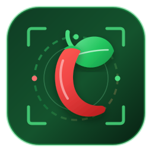

<p align="center">
  
</p>

# ChiliVision · Sistem Monitoring & Pengendalian Tanaman Cabai Pintar

**ChiliVision** adalah aplikasi monitoring dan pengendalian tanaman cabai berbasis **Laravel 13**, **TiDB Cloud** (MySQL-compatible serverless database dengan TLS), **Computer Vision ONNX** (**YOLOv8n / CNN 5-Channel 7 Kelas**), **Chatbot Gemini AI**, **Telegram Bot 2 arah (`@chili_vision_bot`)**, serta **IoT ESP32** (sensor Soil Moisture, DHT22, dan kontrol relay pompa air & pestisida), dilengkapi akses publik HTTPS melalui **Cloudflare Quick Tunnel (`cloudflared`)**.

---

## Pembagian Branch & Jobdesk Tim

| Branch | Jobdesk | Anggota & Akun GitHub | Cakupan Modul |
| :--- | :--- | :--- | :--- |
| [**`backend`**](https://github.com/AbebAli0/Chilivision-Semester5/tree/backend) | **Backend Engineer** | **Ali Zaenal Abidin Al Habsyie** ([@AbebAli0](https://github.com/AbebAli0)) | REST API Laravel, Skema Database TiDB Cloud/MySQL, Chatbot Gemini AI, Integrasi Telegram Bot, & Scheduler |
| [**`frontend`**](https://github.com/AbebAli0/Chilivision-Semester5/tree/frontend) | **Frontend Developer** | **Muhammad Fitrah Abdul Rahman Saleh** ([@mfitrah1502](https://github.com/mfitrah1502)) | Dashboard Monitoring ChiliVision, Live Kamera, Grafik Tren Sensor Soil Moisture & DHT22, & Halaman API Docs |
| [**`training-model`**](https://github.com/AbebAli0/Chilivision-Semester5/tree/training-model) | **Training Model / AI Engineer** | **Daffamanta Ardra Hidayat** ([@Daffamanta](https://github.com/Daffamanta)) | Preprocessing Dataset, Training & Evaluasi Model YOLOv8n & CNN 5-Channel (ONNX), serta FastAPI Inference Worker |
| [**`iot`**](https://github.com/AbebAli0/Chilivision-Semester5/tree/iot) | **IoT & Hardware Engineer** | **Mohammad Sabilillah** ([@sabilillah123](https://github.com/sabilillah123)) | Firmware ESP32, Pembacaan Sensor Soil Moisture & DHT22, Kontrol Relay Pompa Air & Pestisida, serta LCD I2C |
| [**`qa-testing`**](https://github.com/AbebAli0/Chilivision-Semester5/tree/qa-testing) | **QA & Testing Engineer** | **Khairunnisa Nabilah** ([@Khairunnisanabilah50](https://github.com/Khairunnisanabilah50)) | Pengujian Otomatis PHPUnit (37 Feature & Unit Tests), Koleksi Uji API Postman, & Validasi QA Sistem |
| [**`main`**](https://github.com/AbebAli0/Chilivision-Semester5/tree/main) | **Main (Integrasi Utama)** | **Seluruh Anggota Tim** | Gabungan (*Merge*) terintegrasi dari seluruh branch modul (`backend`, `frontend`, `training-model`, `iot`, dan `qa-testing`) |

---

## Fitur Utama

- **Deteksi & Klasifikasi Penyakit Daun Cabai (2 Model ONNX)**
  - `yolov8n-chili` (`yolov8n_chili.onnx`) — *Default*, YOLOv8n Deteksi Objek
  - `cnn-5ch-chili` (`cnn_5ch_7kelas_hard_negative.onnx`) — CNN 5-Channel Klasifikasi Gambar (7 Kelas + Hard Negative)
  - **Kelas Deteksi/Klasifikasi**: `Bercak Bakteri`, `Bercak Cercospora`, `Bercak Putih`, `Daun Sehat`, `Defisiensi Nutrisi`, `Virus Keriting`, serta `Bukan Daun` (*hard negative* untuk menyaring objek non-daun).
  - **FastAPI Warm Inference Worker** (`src/fastapi_app.py` di port `8001`) dengan *circuit breaker* dan fallback otomatis ke `src/inference_cli.py`.
  - **Anti-Duplikasi Gambar**: jika kondisi/visual daun sama dengan deteksi terakhir, gambar tidak diduplikasi ke database (kecuali `force_save=true`).
- **Website Dashboard & API Documentation Interaktif**
  - `/` (`resources/views/chilivision.blade.php`): Live webcam & upload deteksi daun, grafik tren sensor Soil Moisture & DHT22, kontrol semprot manual, chatbot interaktif, status koneksi ESP32 & `system_services`, serta ekspor laporan CSV (`/api/reports/export/{soil|dht22|leaf|spray}`).
  - `/api` (`resources/views/api-docs.blade.php`): Dokumentasi lengkap + playground uji endpoint langsung di browser (`/api?format=json` untuk spesifikasi JSON).
- **Chatbot Gemini AI + Sinkronisasi 2 Arah Telegram (`@chili_vision_bot`)**
  - Mendukung percakapan bebas & perintah cepat (`LeafInferenceService`, `PesticideScheduleService`, `GeminiChatService` dengan model `gemini-3.5-flash-lite` dan fallback `gemini-3.8-flash`).
  - Perintah dari Website langsung diteruskan ke Telegram, dan pesan/foto daun/tombol inline dari Telegram otomatis tampil dan tersinkronisasi di Website Chatbot.
  - Saat penyakit daun terdeteksi, pompa pestisida **tidak** dinyalakan otomatis; bot mengirim konfirmasi **✅ Ya, Semprot Pestisida (5s)** / **❌ Tidak, Jangan Semprot**.
- **Otomasi & Keamanan Penyemprotan IoT ESP32**
  - **Air otomatis**: menyala 5 detik saat kelembapan tanah `< 30%` (ambang batas bisa diubah lewat chatbot, cooldown 60 detik).
  - **Pestisida terjadwal**: default tiap **5 hari (120 jam)**, interval maupun jadwal tanggal spesifik dapat diubah lewat chatbot dan dipantau setiap menit oleh scheduler `chilivision:check-schedule`.

---

## Struktur Proyek

```text
Project/
├── app/
│   ├── Http/Controllers/ChiliVisionApiController.php
│   ├── Models/                  # ChatbotMessage, Dht11Reading, LeafDetection, SoilMoistureReading, SprayHistory, SystemSetting
│   ├── Providers/AppServiceProvider.php
│   └── Services/                # GeminiChatService, LeafInferenceService, PesticideScheduleService
├── config/                      # Konfigurasi Laravel, database MySQL/TiDB SSL, Gemini & Telegram
├── database/migrations/         # Skema tabel & normalisasi label penyakit daun
├── esp32/
│   ├── esp32_lama/              # Firmware ESP32 utama + secrets.example.h (secrets.h tidak di-commit)
│   └── esp32_laravel_controller/# Referensi firmware ESP32 kontroler Laravel
├── models/                      # File model .onnx, .pt/.keras, dan *.names.json (Git LFS)
├── postman/                     # Koleksi pengujian endpoint REST API Postman
├── public/models/               # Salinan aset model publik
├── resources/views/             # chilivision.blade.php & api-docs.blade.php
├── routes/                      # web.php, api.php, console.php
├── src/                         # fastapi_app.py, inference_cli.py, telegram_bot.py, train/eval/export scripts
├── storage/certs/               # CA certificate TiDB Cloud (tidak di-commit ke Git)
├── tests/                       # 37 PHPUnit feature & unit tests (SQLite :memory:) + phpunit.xml
├── start_server.bat             # Launcher utama seluruh layanan (Windows)
├── stop_server.bat              # Menghentikan seluruh layanan background
├── start_telegram_bot.bat       # Launcher terpisah khusus Telegram Bot
├── stop_telegram_bot.bat        # Menghentikan Telegram Bot
├── .env.example                 # Template konfigurasi lokal
└── .env.cloud.example           # Template konfigurasi TiDB Cloud / container
```

---

## Persyaratan & Instalasi (Windows 11)

- **PHP 8.3+** (direkomendasikan PHP 8.4 via Herd/XAMPP) & **Composer**
- **Python 3.11** (untuk FastAPI/ONNX inference & `telegram_bot.py`)
- **XAMPP Apache** *(opsional, direkomendasikan)*: jika tersedia di `E:\xampp\apache\bin\httpd.exe`, `start_server.bat` otomatis memakai Apache Load Balancer + 6 worker PHP + Gzip di port `8000`; jika tidak, otomatis fallback ke `php artisan serve`.
- **Cloudflare Tunnel (`cloudflared`)** *(opsional)*: otomatis membuat URL HTTPS publik (`https://<subdomain>.trycloudflare.com`) untuk diakses dari HP/ESP32 jarak jauh tanpa konfigurasi router/port forwarding.

### Langkah Setup Awal

1. **Instal dependensi PHP & Python**:
   ```powershell
   composer install
   python -m pip install --upgrade pip
   pip install -r requirements.txt
   ```
2. **Konfigurasi environment `.env`**:
   ```powershell
   Copy-Item .env.example .env
   php artisan key:generate
   ```
   Sesuaikan di `.env`:
   - **Database (TiDB Cloud Starter / MySQL)**:
     - Untuk TiDB Cloud (`gateway01.ap-southeast-1.prod.aws.tidbcloud.com`, port `4000`, database `chilivision_db`), simpan sertifikat CA (mis. `storage/certs/cacert.pem`) dan isi `MYSQL_ATTR_SSL_CA` dengan path absolut ke file sertifikat tersebut.
   - **API Keys**:
     - `TELEGRAM_BOT_TOKEN` (dan `TELEGRAM_CHAT_ID`, terisi otomatis saat pertama kali chat bot di Telegram)
     - `GEMINI_API_KEY` (opsional, untuk respons AI natural pada chatbot)
3. **Jalankan migrasi database**:
   ```powershell
   php artisan migrate
   ```

---

## Menjalankan Aplikasi

Cukup jalankan **`start_server.bat`** (klik dua kali atau lewat terminal):

```bat
start_server.bat
```

Skrip ini otomatis menjalankan secara terpadu:
1. **FastAPI Warm Inference Worker** (`127.0.0.1:8001`)
2. **Telegram Bot** (`src/telegram_bot.py`) dengan pemaksa rute IPv4 agar stabil
3. **Laravel Scheduler** (`php artisan schedule:work`) untuk `chilivision:check-schedule`
4. **Cloudflare Quick Tunnel** (`cloudflared tunnel --url http://127.0.0.1:8000`) dan menyimpan URL publik ke `storage/logs/cloudflare_url.txt`
5. **Web Server Port `8000`** (Apache multi-worker + 6 proses PHP 8.4 + Gzip, atau fallback `php artisan serve`)

Untuk menghentikan seluruh layanan, jalankan:

```bat
stop_server.bat
```

---

## Integrasi ESP32 (Arduino IDE)

1. Buka [esp32/esp32_lama/esp32_lama.ino](esp32/esp32_lama/esp32_lama.ino) di Arduino IDE.
2. Salin [esp32/esp32_lama/secrets.example.h](esp32/esp32_lama/secrets.example.h) menjadi `esp32/esp32_lama/secrets.h` (file ini di-ignore oleh Git agar kredensial aman).
3. Isi `WIFI_SSID`, `WIFI_PASSWORD`, dan `API_BASE_URL` (gunakan URL Cloudflare aktif + `/api`, misalnya `https://<subdomain>.trycloudflare.com/api`, atau IP lokal laptop Anda saat satu jaringan).
4. Instal library ESP32 board, `DHT sensor library`, `Adafruit Unified Sensor`, `ArduinoJson`, dan `LiquidCrystal_I2C`.

### Mapping Pin GPIO

| Komponen | `esp32_lama.ino` | `esp32_laravel_controller.ino` |
|---|---:|---:|
| Sensor Soil Moisture (Analog) | GPIO 35 | GPIO 34 |
| Sensor DHT22 (Digital) | GPIO 4 | GPIO 4 |
| Relay Pompa Air (Active LOW) | GPIO 26 | GPIO 26 |
| Relay Pompa Pestisida (Active LOW) | GPIO 27 | GPIO 27 |
| I2C LCD (SDA / SCL) | GPIO 21 / 22 | - |

> Pastikan pompa menggunakan catu daya terpisah melalui modul relay/driver dengan proteksi yang sesuai, bukan langsung dari pin GPIO ESP32.

---

## Perintah Chatbot & Telegram (`@chili_vision_bot`)

- `/status` — Ringkasan kondisi daun, sensor tanah, DHT22, & histori penyemprotan
- `model` / `/model` — Memilih model AI aktif (`yolov8n-chili`, `yolov10n-chili`, `yolov11n-chili`, `cnn-6ch-chili`)
- `/semprot_air` — Menyemprot air secara manual (5 detik)
- `/semprot_pestisida` — Menyemprot pestisida secara manual (5 detik)
- `/cek_daun` — Melihat deteksi gambar daun terakhir
- `/cek_tanah` — Melihat data sensor Soil Moisture terakhir
- `/cek_suhu` — Melihat data sensor DHT22 terakhir
- `/histori` — Melihat histori & jadwal penyemprotan berikutnya
- `ganti jadwal pestisida <n> hari sekali` / `ubah batas semprot air <n>%` — Mengubah jadwal & ambang batas otomatis secara dinamis

---

## Pengujian & Kualitas Kode

```powershell
php vendor/bin/pint --dirty --format agent
php artisan test --compact
```

Test suite memakai database SQLite `:memory:` sesuai konfigurasi di `phpunit.xml` sehingga aman dijalankan tanpa memengaruhi data produksi di TiDB Cloud.
